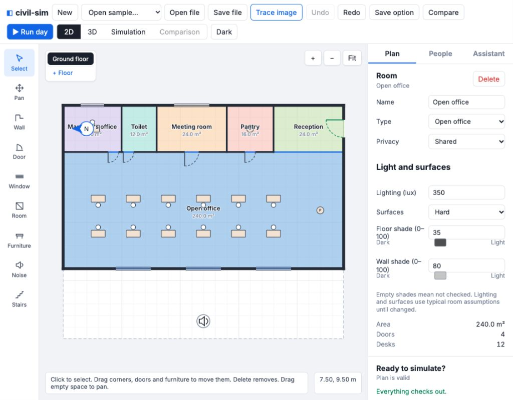
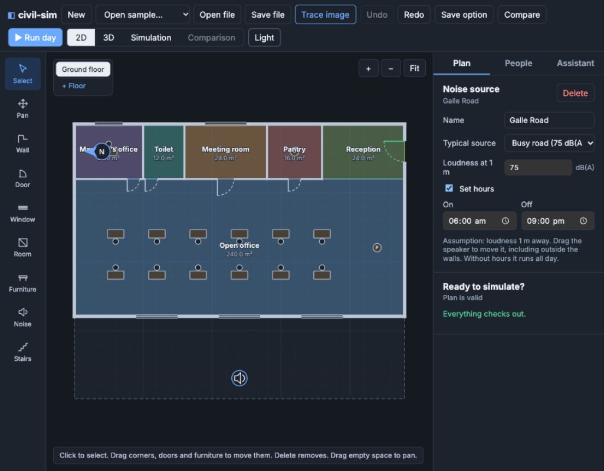
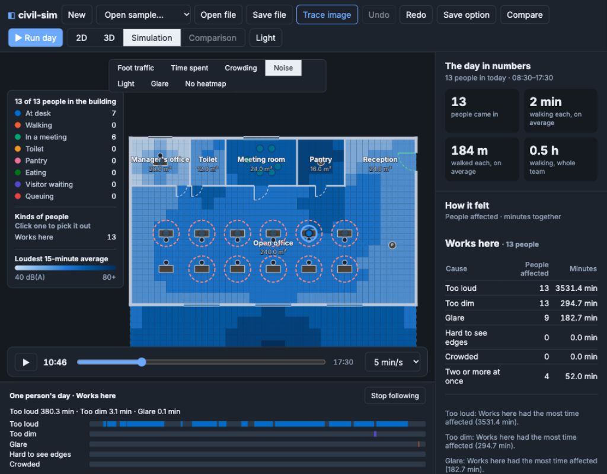

# App v0.7 comfort handoff

Built on `app/v0.7-comfort` from engine commit `1d5d35f`, under the product owner's temporary authorization for Codex to edit the app. Ready for Claude's review; no merge or push.

## What changed

- **Plan:** North angle and latitude fields, plus an arrow whose body can be dragged and whose tip rotates north. Window inspection adds sill/top, clear/tinted/custom glass, frosting and shading. Room inspection adds typical lighting and surfaces, optional floor/wall shades, swatches and the low-contrast note. A Noise tool places movable, deletable speakers with names, presets, levels and on/off hours, including outside walls within the plan bounds. All saved plan changes use `planOps.ts` and the existing history. Noise sources also appear in assistant proposal highlights and are removed with their floor.
- **People:** Comfort on/off, date and clear/overcast sky; new profiles start on with 2026-03-21. Older saved profiles with no comfort field stay off. Each kind gains the five comfort controls. Low vision and Sensitive to noise and light use the supplied sample's exact profile values and small visitor/shopper shares in every mix. Typical room values and tolerances come from `model/comfortDefaults.ts`.
- **Results:** “How it felt” shows affected people and total minutes for each cause and overload, with short worst-kind sentences. Kinds with nobody assigned are omitted from the UI. Room cards show noise/time, minimum light, glare/time, contrast and discomfort, sorted by discomfort with plan-order ties. Desks show glare/noise minutes and are ringed in playback. Existing Problems found includes comfort warnings.
- **Playback:** Noise (40–80 dB(A)), Light (0–1000 lux, dark at the dim end) and Glare (0–1) maps appear with comfort results. The legend distinguishes the loudest 15-minute sound average from the minimum light and maximum glare. Hover text gives values in words. Click a person to highlight them and see a labelled, five-row discomfort strip under the timeline; click empty space or Stop following to clear it. Comparisons share the fixed scales.
- **Assistant:** Strict nullable-field tools for site, glass, finishes, noise sources and comfort; kind tools accept tolerances and low vision. Descriptions include these settings. The system prompt supports combined glazing/finish/orientation/road proposals and states the model's limits and assumption requirements.
- **Presentation:** Added light/dark theme selection (initially the saved or system preference), corrected the top-bar overflow at 1024 px, wrapped heatmap controls, kept long labels readable and added the two supplied comfort plans to Open sample.

## Verification

- App: **103 tests pass in 16 files**, including every prior test. Two prior expectations were updated for intentional new behavior: nine shopper kinds instead of seven, and comfort warnings allowed while still asserting no movement warnings.
- New tests cover the complete shared default table, both exact sample presets, mix shares, valid comfort-on/off expansion and older-profile round trips, plan validation/save/open/undo/redo for site/glass/finishes/noise, source removal/floor filtering, all six new assistant tools with accepted and refused inputs, recursive strict schemas, nullable preservation/clearing, extended kind tolerances, and a combined proposal.
- End to end: `office-a-comfort` with the app's unmodified default profile produces west-facing desk glare; the full ResultsPanel and comfort/editor components render. Heatmap availability, fixed scales and light/noise colours are checked.
- `cd app && npx tsc -b` and `npm run build` pass. Vite still reports its large-bundle advisory (the app includes the existing 3D viewer); no build errors.
- Engine: **216 tests pass in 17 files**; engine type check passes. All eight `npm run check:contracts` sample pairs pass. Engine, contracts and sample JSON are unchanged by this app work.
- Browser: reviewed at **1024 × 800**, light and dark. Checked room/window/noise controls, custom glass and shading with undo, dragging north and an outdoor speaker, tolerance controls, all three maps, desk rings, and selecting a person for the discomfort strip. Tables and controls fit the sidebar. Test edits were undone.

## Screens

Room finishes in light mode:

Outdoor noise source and hours in dark mode:

Playback and one person's discomfort:

## Decisions and limits

The arrow's on-screen position is a local canvas aid; only its direction is saved, because the contract has no arrow-position field. Moving that aid does not create a plan history step; rotating it does. Room fields can be cleared to restore typical lighting/surfaces or unchecked shades. Assistant null means keep; -1 clears optional numeric finishes, `typical` clears the surface override, and `all_day: true` clears source hours.

The UI reports desk comfort across opening hours, including time nobody sat there, and person-minutes separately. It uses the engine's approved default-profile row in mixed populations. The engine's assumptions and calibration limits remain visible. No live model/API request was made: assistant tool execution and proposal contents were tested locally, without a key or charge.
