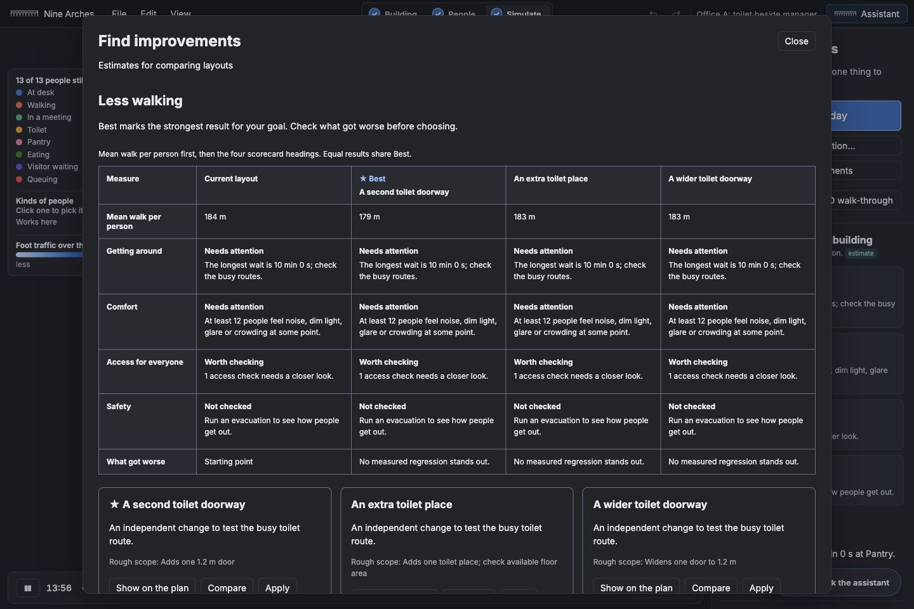
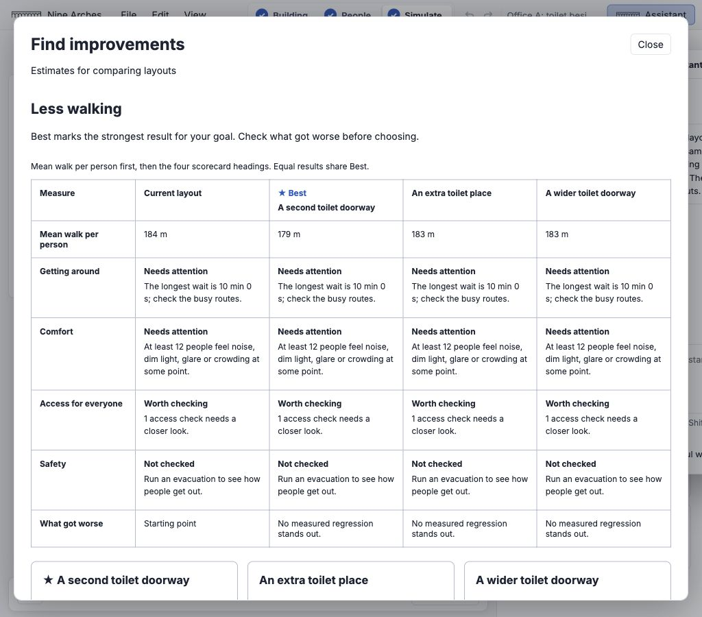
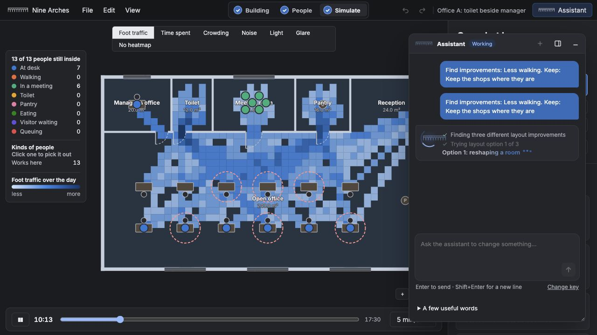
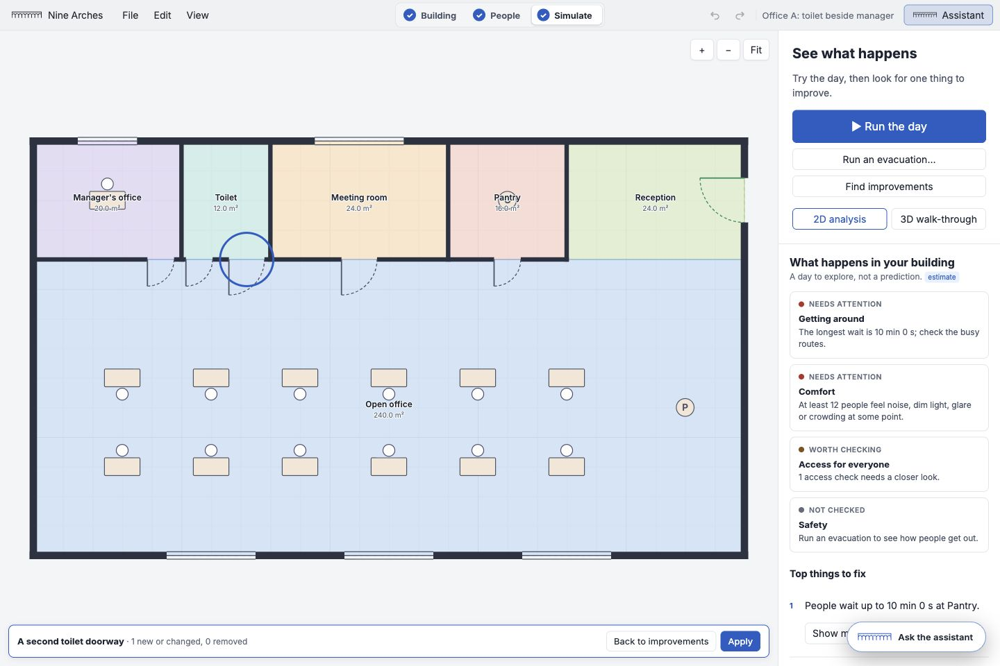
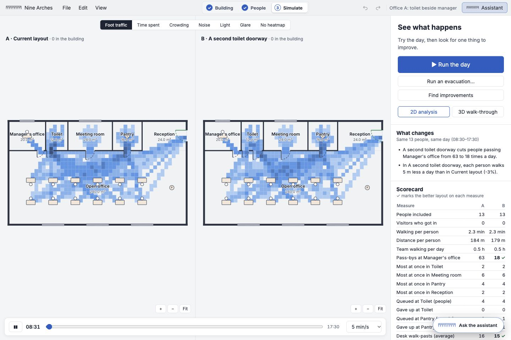
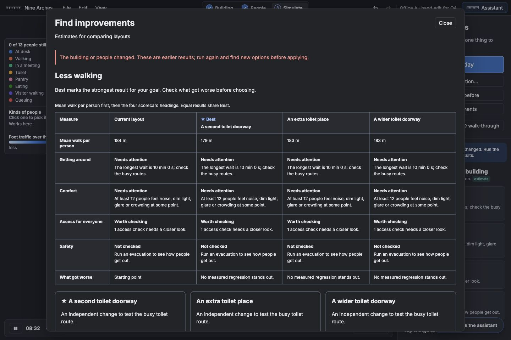

# Find improvements

Branch: `app/find-improvements`, based on `app/polish`. No merge or push. App-only implementation; the parent's five approved engine test-data refreshes are described in the polish report. No contract or engine source changes.

## What changed

Simulate has a Find improvements button. Choose shorter waits, less walking, comfort, easier access, getting everyone out, or the first Top things to fix item; optional free-text restrictions guide the assistant. Comfort goals require comfort measurements; evacuation goals require an evacuation run, retaining its alarm and blocked exits. Missing measurements are stated rather than scored as zero.

The existing assistant makes exactly three independent drafts in separate conversations, starting from separate copies of the same plan and people. Each has a reason and rough physical scope. It can use existing layout tools, but cannot change the people, hours, seed, weather or alarm. API generation is cancellable and its tool activity appears live in the assistant window. No paid live assistant request was made during QA: the SDK was mocked in tests and in a temporary browser-only QA server, whose config was removed before commit.

Each option runs sequentially in a dedicated, terminable browser worker. The app's existing scenario recaster keeps identities and seed; options that drop people, meetings or required daily activities are refused as unfair comparisons. Normal days are compared for every goal; getting-out goals also run the evacuation for the base and each option. Cancellation aborts API requests or terminates an active worker, leaving the building untouched.

The ranking puts the goal's main measure first, followed by Getting around, Comfort, Access for everyone and Safety, then measured regressions. Safety prioritizes stranded people, then people at refuges, then exit time; access prioritizes blocked trips and common-guidance checks before lift wait. Walking includes shoppers and visitors rather than using the legacy staff-only summary. Top-problem goals target that problem's room, desk or warning. Ties share Best and have stable option-id ordering; when nothing improves, the flow says so. All figures are estimates for comparing layouts.

Each successful option opens the shared proposal view, the existing side-by-side comparison, or Apply. Apply records one undo entry with the frozen people settings, and refuses changes to either the building or people made since the experiment began. Stale rankings are labelled and Apply is disabled. Existing assistant proposals are preserved, not silently discarded.

Free-text restrictions are instructions to the assistant, not a geometry lock: the flow explicitly asks the user to review them on the highlighted draft. Rough physical scope is an assistant estimate, not a priced quote. Proposal quality with a live model remains unverified. This prototype continues using the existing browser API-key setup.

## Validation

- All **166 app tests** passed (22 files, 20.55 s). The 11 new tests cover goal mapping, ties, nothing-helps, safety priority, independent drafts, same people/seed, both evacuation/day runs, deterministic unchanged-layout results, disallowed tools, cancellation, single undo and hand-edit refusal. The affected 11 tests and typecheck were rerun after clarifying the no-step-free-people message and passed.
- App typecheck, root `npx tsc -b`, app TypeScript build check, all 11 contract pairs, production build and whitespace checks passed. Vite bundling: 2.50 s. Worker bundle: 174.83 kB. Existing large-main-bundle advisory remains.
- The inherited engine suite is **283/285 passing** after the approved hash refresh. Two unchanged timing limits fail on this machine; see [polish-report.md](polish-report.md). No assertion or timeout was relaxed.
- Browser: goals, generation progress, cancellation, real worker execution, ranking, proposal highlighting, side-by-side Compare, Apply, Undo, evacuation prerequisites and disabled Apply after a hand edit. Light/dark ranking at 1024 and 1440 px; computed-style visible-text contrast audit found no body-text failures in the ranking.

In the mocked-assistant office example, three real layout changes were simulated: an extra toilet place, a wider toilet doorway and a second toilet doorway. The second doorway ranked first, reducing mean walking from **184 m to 179 m** and manager-office walk-pasts from **63 to 18**. The longest pantry wait remained 10 minutes and stayed visible as Needs attention. These numbers describe those scripted layouts, not a claim about live AI quality.

## Screenshots

Other requested theme/width captures and the goal screen are alongside these in images/improvements. QA used separate origins and temporary tabs; the user's project at port 5174 was preserved.
