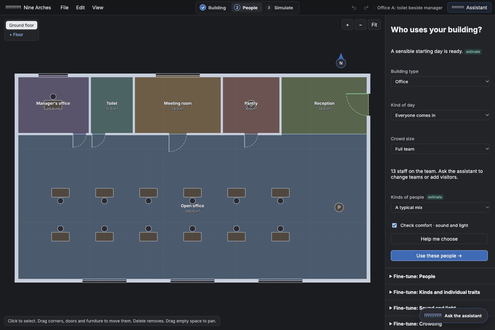
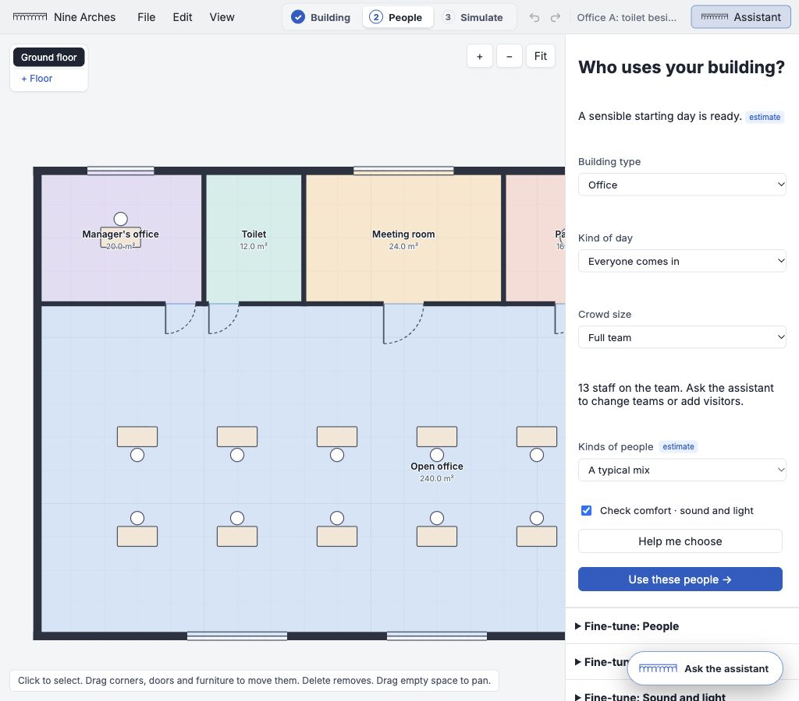
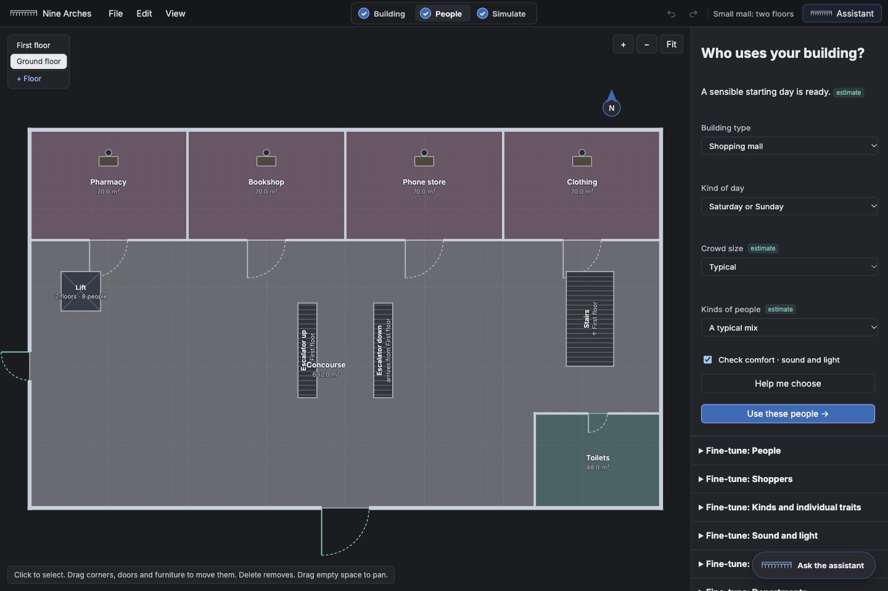
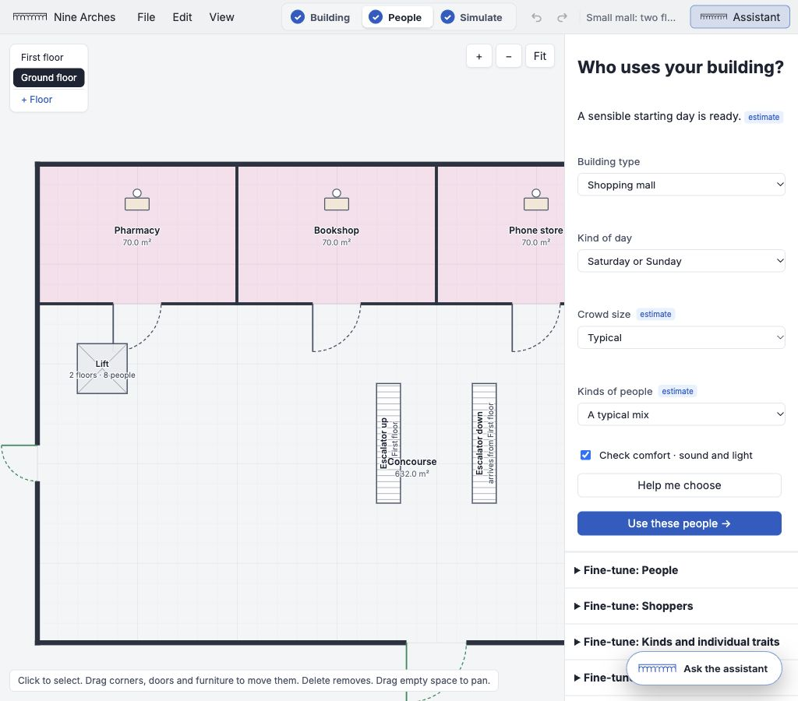
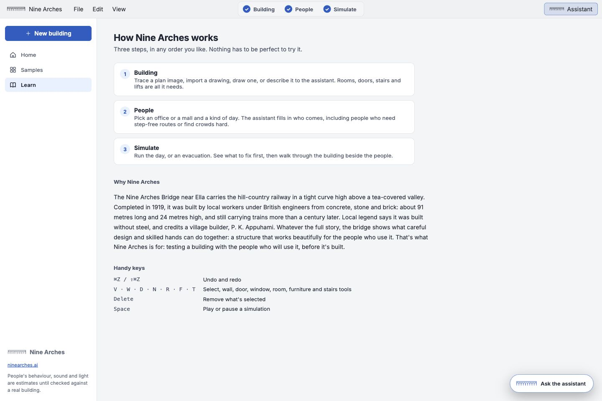

# Nine Arches rename and polish

Branch: `app/polish`. Rename is the first commit (`2cf5319`). No merge or push.

The product, app bar, home, browser title, assistant wording and exported filename use the new identity. The nine-arch placeholder and wordmark live in Brand.tsx, with an SVG favicon derived from the mark. Existing storage keys and project format remain unchanged. Tests open `.volt.json`, `.civilsim.json`, ordinary `.json` and new `.ninearches.json` files. Learn includes the owner's supplied name history, with legends still identified as legends.

Simple People now offers type, day, crowd, people mix and comfort, with details behind Fine-tune. Choosing mall from office hours adopts mall hours. Office custom attendance remains visible rather than showing an empty choice. Removed 236 lines of obsolete flow/home/drawer styles and obsolete topbar rules after searching their class names in TS/TSX; retained the live prepared-prompt and shared sidebar rules.

## Contrast

Foreground and background token changes (sRGB relative luminance):

| Use | Before | After |
| --- | ---: | ---: |
| Light secondary text | 3.09:1 | 5.30:1 |
| Dark secondary text | 4.36:1 | 6.00:1 |
| Dark primary button | 2.75:1 | 5.32:1 |
| Light warning text | 3.64:1 | 6.67:1 |

Accent text is separate from filled controls; status marks use semantic tokens. Browser computed-style checks of visible body text returned no failures below 4.5:1 on Home/Learn, office and mall People, optional building settings, result story and the assistant in the inspected themes. Large headings/icons use the 3:1 minimum. This is an audit of available states, not a claim about every possible user-coloured imported plan. Scorecard signals include words; people kinds include shapes; discomfort strips have named rows and time labels; heatmaps retain numeric hover values and a labelled scale.

## Mall food court

Added a 3 m door at offset 10 m in a wall along the existing food-court/concourse boundary (y=16, x=0–14). Both spaces list the door. Only three generated plans change: mall-2f, mall-2f-comfort and mall-2f-evac. Office samples and all scenario files stay identical.

| Seeded sample | Food court walk-pasts before → after | Shop/food visits before → after |
| --- | ---: | ---: |
| mall-day | 0 → 0 | 0 → 0 |
| mall-weekend | 0 → 478 | 3022 → 3022 |
| mall-weekend-people | 0 → 510 | 3010 → 3004 |
| mall-weekend-comfort | 0 → 512 | 3012 → 3004 |
| mall-weekend-evac | 0 → 339 | 2111 → 2112 |

People counts stay 14 for mall-day and 847 for the weekend scenarios. Rounded staff walking totals are unchanged. Detailed observations are in [polish-sample-results.json](polish-sample-results.json); the engine's perPerson table covers office staff, so these are not whole-crowd walking totals.

## Live surroundings

Pressed Fetch surroundings once in the browser using office-a-site's saved location (6.9, 79.853), against the default main Overpass service. The existing fallback also ran. Both timed out; no fresh buildings or roads returned, and the two sample neighbours and road were preserved. The raw abort error exposed a wording bug: now it says “The surroundings service took too long. Retry later.” A regression test covers it. A successful live response and its height markers remain unverified because the external services did not respond. Existing conversion tests cover data, floor-derived and assumed heights.

## Validation and screenshots

All 155 app tests passed, including the legacy-filename and timeout regressions. App typecheck, production build (2.22 s Vite bundle), all 11 contract pairs and diff whitespace checks passed. Existing bundle-size advisory remains. No contract or engine files changed. The optional broader engine check found 15 historical mall-hash mismatches from the requested doorway; a proposed test-data-only refresh is in [polish-baseline-refresh.patch](polish-baseline-refresh.patch), pending a scope exception. Timing rechecks are recorded below.

A resize check also found that a floating assistant could leave its minimise button outside the viewport; its horizontal clamp now keeps the whole title bar on screen.

Office and mall People were inspected at 1024 and 1440 px in light and dark on the isolated QA origin; the user's project at port 5174 was preserved. Full-page captures avoid browser screenshot clipping with viewport overrides.

Other theme/width captures are alongside these in images/polish.
