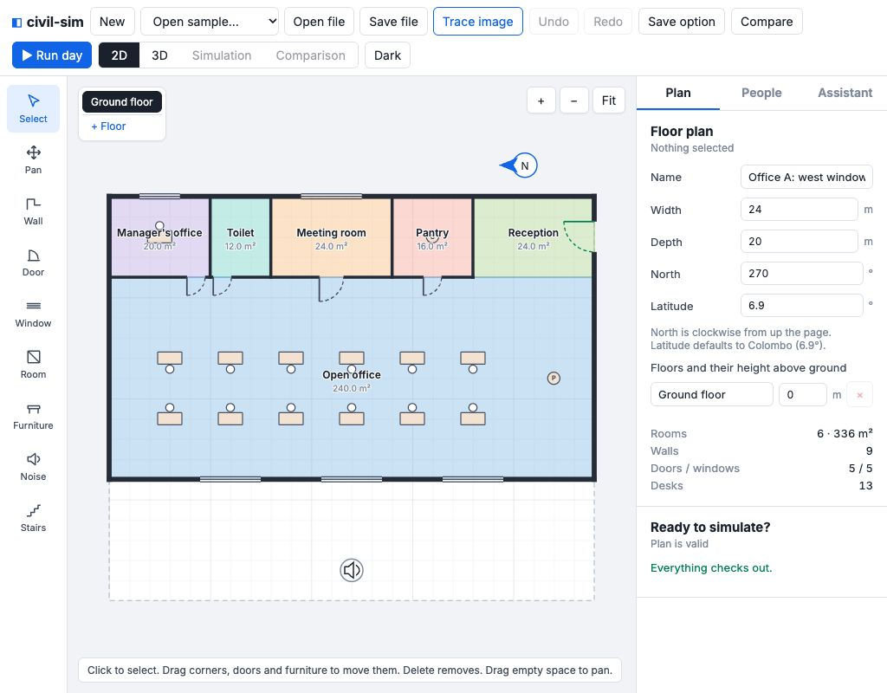

# v0.7.2 review fixes

Implemented on `app/v0.7.2` from `integrate/v0.7` (`5008002`). Contracts and sample JSON are unchanged.

## Changes

- A shared app helper labels both desk tables, matching comfort warning wording: numeric id suffixes become “Desk 8”; ids without a numeric suffix use “The desk in Manager's office”. Room context is retained in tables. Inserting or reordering furniture no longer renumbers desks.
- Desk work, meetings and shopping retain the full task-light need. Eating, lunch, pantry and waiting use half; walking remains at a quarter. Engine assumptions and the People tab explain this.
- Typical focus noise stays 50 ± 3 dB(A), with limits changed to **46–58** in the engine and app. Explicit profile tolerances are preserved, including the low-vision preset's supplied 42–58 spread and the sensory preset's 44 mean.
- The north arrow starts above the plan, clear of room labels, with reserved canvas space. Dragging its body can keep it outside the building; rotating its tip remains an undoable north edit. Opening a different plan restores the default placement.

## Office A comfort with the app's default people

Unmodified `defaultProfile(office-a-comfort)`: 13 staff, seed 42, 08:30–17:30, 2026-03-21, clear. Each cause cell is **person-minutes / people affected**; overload is two or more causes at once. Unassigned kinds (zero people) are omitted, as in the app.

| Kind | People | Too loud | Too dim | Glare | Hard to see edges | Crowded | Overload |
|---|---:|---:|---:|---:|---:|---:|---:|
| Works here | 13 | 853.28 / 12 | 0.00 / 0 | 182.74 / 9 | 0.00 / 0 | 0.00 / 0 | 30.53 / 1 |

Dim time falls from 294.69 minutes affecting 13 people to zero. Total loud time falls from 1234.03 to 853.28 person-minutes; glare and movement are unchanged.

| Desk | Loud minutes before | Loud minutes after |
|---|---:|---:|
| Desk 3 | 278 | 19 |
| Desk 10 | 540 | 307 |

No desk is loud for the full 540 minutes. Desk 10 still exceeds its drawn tolerance for 307 minutes.

## Verification

- **249 engine tests** across 19 files and **107 app tests** across 17 files pass. Both type checks (including app `npx tsc -b`) the production app build, and all eight `npm run check:contracts` pairs pass.
- New tests check full/half/quarter light needs and their boundaries, dark desk work still being detected, the new typical noise floor, preservation of explicit tolerances, a quiet 45 dB office, default-profile results and movement, list-order-independent labels, and an actual engine warning agreeing with both rendered desk tables.
- Complete outputs for all six older comfort-off sample pairs match hashes captured from v0.7.1 before edits. The default app profile's comfort-off result also matches exactly, despite the updated tolerance defaults. The default office run retains identical tracks apart from discomfort, and identical events. Existing engine tests cover deterministic output, unchanged movement on both comfort samples, legacy hashes, walls/access, crowding, closing, toilets and speed.
- Browser checked at 1024 × 800 in light and dark: the arrow opens above the plan, the manager's label stays clear, dragging can stay outside the outline, and rotation writes north and undoes correctly. Test edits were undone.
- The first concurrent engine/app run exceeded three older mall tests' 5-second timeouts. Separate suite runs use the existing timeouts; none were widened.

Reproduce with `npm test --prefix engine`, `npm run typecheck --prefix engine`, `cd app && npx vitest run && npx tsc -b`, and `npm run check:contracts`. Before/after default-office results and captured comfort-off hashes are in ignored `engine/out/v072-*` files.
