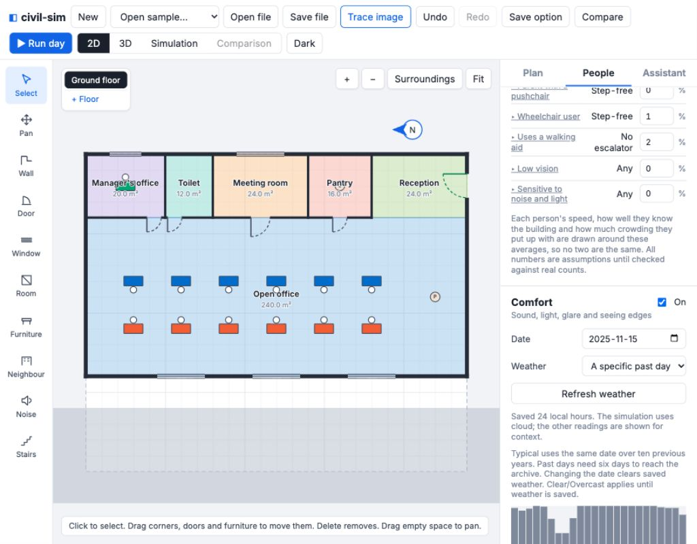
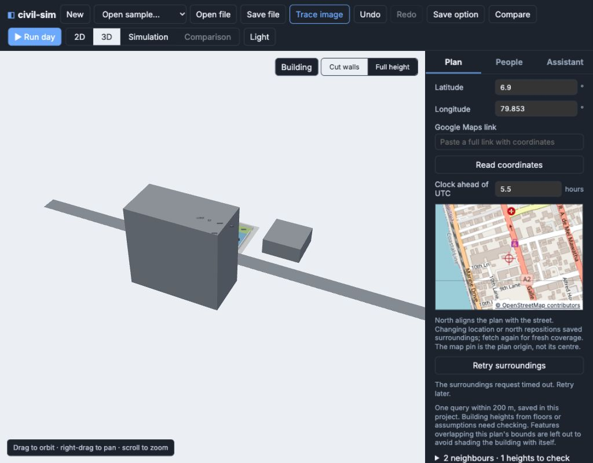

# v0.8 — site and weather

Implemented on `v0.8-site`, based on `app/v0.7.2` (`3e1bac3`), with the approved
contract/sample setup merge. No contract or sample edits were made by this implementation.
No push or merge back.

The engine now traces sun past solid neighbouring footprints at their heights,
including the observer floor elevation; estimates visible sky; integrates road
sound along paths; applies saved hourly cloud; and reports window exposure and
weather/source credits. Movement is unchanged. The app adds site coordinates and
Maps-link parsing, a small attributed OSM map, explicit surroundings/weather fetch,
manual neighbours and roads through the assistant, height correction, 2D/3D site
views, saved project data, weather strips and window results. Undo/Redo includes
People settings and weather, and assistant proposals remain one undoable step.

## Fixed sample comparison

These are the supplied fixtures, not fetched observations: `office-day-site`
uses illustrative typical 15 November cloud and two neighbours; the older
`office-day-comfort` uses clear 21 March. Their differences include date, cloud,
road model and neighbours, so this comparison alone does not isolate a tower.
The regression test separately removes neighbours with date and sky held fixed:
at 16:00 all three west windows are fully shaded with the tower, and receive
sun again without neighbours. Desk-facing glare returns in the unshaded case.
A ray above a six-metre neighbour remains unblocked.

| Window | Older sun min | Site sun min | Neighbour shade min | Cloud min |
|---|---:|---:|---:|---:|
| Manager | 205.0 | 116.0 | 0.0 | 89.0 |
| Meeting | 205.0 | 116.0 | 0.0 | 89.0 |
| West 1 | 335.0 | 46.2 | 222.3 | 66.5 |
| West 2 | 335.0 | 46.3 | 222.0 | 66.7 |
| West 3 | 335.0 | 61.7 | 164.7 | 108.6 |

All reported site desk glare minutes are zero; the older fixture has eight desks
with nonzero glare (1–180 minutes). The site's loudest affected desk has 473
loud minutes; the older maximum is 30. The road-facing side is louder in a separate
stationary sound check. Roads lose about 3 dB per distance doubling versus about
6 dB for point sources, subject to walls, finite road length and sampled cells.

## Real fetch and browser check

Checked the sample location **6.9 N, 79.853 E, Colombo** in the browser at
**1024 × 800**, in light and dark themes. OSM tiles loaded with visible attribution.
Selecting an assumed neighbour and correcting 6 m to 9 m changed the provenance
to user-entered; Undo restored the old state. Grey blocks and roads render in 3D,
with a surroundings overview button; the estimated height is highlighted in 2D.
Saved weather drives the engine and the result labels the sky as a specific day.

Open-Meteo successfully returned **24 local hours for 2025-11-15**, UTC+5:30,
and the source/date, cloud strip, temperatures and rain appeared in the app.
The unmodified response is recorded under `app/src/site/fixtures/`. Typical-day
fetching is tested with ten sequential mocked archive replies built from that
recording; it was not exercised live for all ten years.

**Outstanding live-service verification:** no successful Colombo Overpass response
could be captured. The main endpoint returned HTTP 406; private.coffee returned
429 or timed out, and the alternate documented VK endpoint timed out. The app
showed a plain timeout and Retry while retaining the existing two sample neighbours
and road. Successful surroundings conversion currently has constructed tag/geometry
coverage, **not the requested recorded successful Overpass fixture**. A successful
live import and that additional recorded fixture remain to be checked when the
service is reachable. No automatic retry/provider loop was added.

## Validation and timings

- All eight complete older result hashes match the pre-change captures from
  `3e1bac3`, after normalizing result version and removing only new window/weather
  output fields. This includes comfort-off pairs. Captures are checked in.
- Engine regressions cover deterministic immutable execution, unchanged movement,
  tower/sky obstruction, floor height, full cloud, longitude/UTC offset, line/point
  decay, road hours and the road-facing side.
- App tests cover link forms/refusals, metre conversion/rotation/reprojection,
  height/kind inference, long-road clipping, 24 local weather hours and half-hour
  interpolation, typical averaging, failure handling, validation, undo/redo and
  all new assistant tools with accepted/refused input. Tests make no live requests.
- Engine: 249 existing tests plus 15 v0.8 tests pass (the full 263-test run took 91.3 s; the final 15-test site rerun took 9.2 s). App: all 123 tests pass in 4.8 s.
- Engine and app type checks, `npx tsc -b`, contract sample checks, production build
  and both full test suites pass. The build retains its existing large-chunk warning.

Median of three complete simulations, after warm-up (`npm run benchmark:site`):

| Pair | Median |
|---|---:|
| Office site | 261 ms |
| Office comfort | 199 ms |
| Mall comfort | 3308 ms |

The existing benchmark also passed v0.7 comfort limits (office 249 ms, mall 3222 ms).
Its comfort-off comparison against the original `6503fc5` baseline measured ratios
0.888–1.013 across six pairs, within the 10% limit. These are local timings,
not browser device guarantees.

## Model limits and decisions

Nine samples estimate partial window shade, 45 rays estimate blocked sky, and
cloud is held constant within each clock hour. Exposure minutes are equivalent
minutes before blinds/frosting. Roads are one-metre line sections; no traffic
prediction, reflections or neighbour sound shielding is added. Temperature,
humidity and rain do not affect behaviour or thermal comfort yet.

The app clips long imported road ways to 250 m each side of the origin and omits
footprints overlapping the plan bounds to avoid self-shading. Check adjacent
buildings and inferred heights. Changed location/north reprojects saved geometry;
a fresh fetch gives current coverage. Source data and API availability are outside
the deterministic engine. Deployment can configure its Overpass/tile provider;
see the app README and the decision entry for details.
