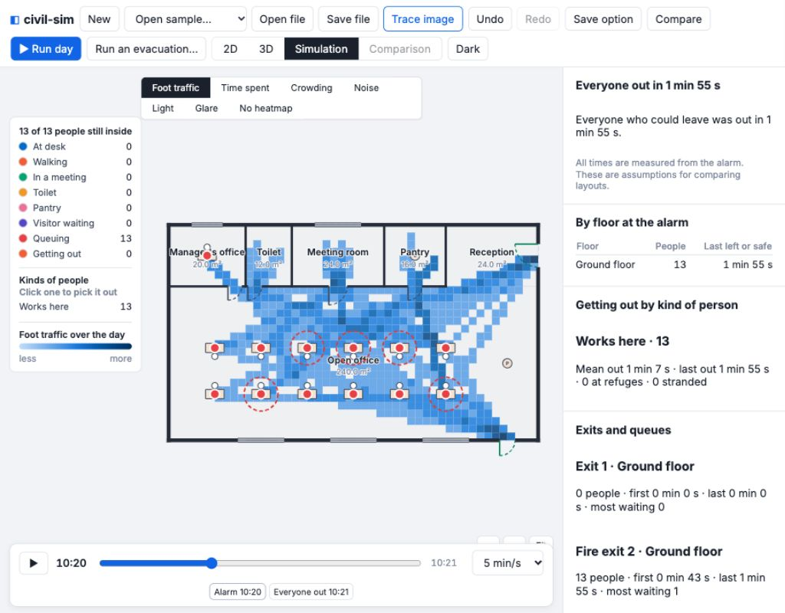
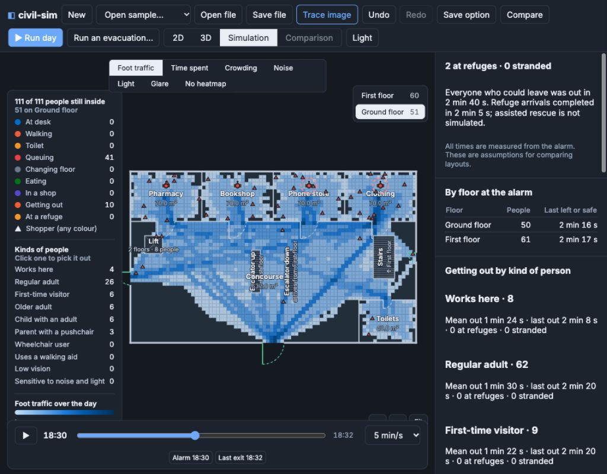
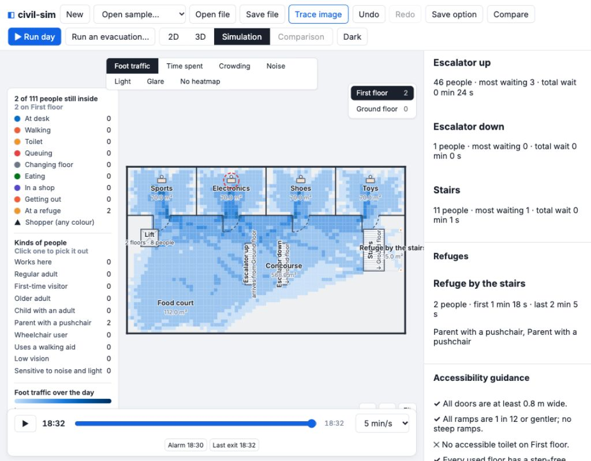

# v0.9 — evacuation and accessibility

Implemented on `v0.9-evacuation`, based on approved contract commit `70e9fe9`. No contract or sample JSON edits. No merge or push.

## Built

The engine preserves the normal seeded day up to the alarm, suppresses later arrivals, draws independent reactions and runs exit/refuge movement through shared density, door, connector and lift queues. Fire exits are excluded from ordinary arrivals/departures. Ramps, accessible toilet selection, five accessibility checks and plain warnings are implemented. Comfort ends at the alarm.

The app adds a Ramp tool and gradient, safety checkboxes, separate evacuation setup/run, evacuation comparison, timeline markers, inside counts and evacuation/accessibility results. Assistant proposals use the same undoable operations. The main Overpass endpoint now receives a POST form, with one mirror fallback only after failure. The supplied real Colombo response is copied unchanged with © OpenStreetMap contributors (ODbL) credit; tests cover its 140 buildings, seven height tags, ten floor-count tags, Galle Road and Marine Drive.

## Supplied evacuation fixtures

Times below are seconds from the alarm. They come from the supplied scenario JSON, not the app’s default People profile. The browser run uses the app profile, so its totals differ while preserving the people and seed between its day and evacuation.

### office-day-evac

Alarm **10:20**; 14 inside. **14 out by 118.0 s**, 0 at refuges by 0.0 s, **0 stranded**. Median runtime **35.5 ms** (three measured runs after warm-up).

| Floor at alarm | People | Last departure or safety, s |
|---|---:|---:|
| Ground floor | 14 | 118.0 |

People who reach a refuge remain on that floor. “Last departure or safety” does not mean a refuge floor is physically empty.

| Kind | People | Mean out, s | Last out, s | At refuge | Stranded |
|---|---:|---:|---:|---:|---:|
| Unprofiled staff/visitors | 14 | 74.7 | 118.0 | 0 | 0 |

| Exit (plan order) | People | First out, s | Last out, s | Most waiting |
|---|---:|---:|---:|---:|
| Exit 1 | 8 | 43.1 | 107.9 | 0 |
| Fire exit 2 | 6 | 33.8 | 118.0 | 0 |

No connector trips or connector queues after this alarm; exit queues peak at zero.

### mall-weekend-evac

Alarm **18:30**; 96 inside. **92 out by 154.7 s**, 4 at refuges by 87.1 s, **0 stranded**. Median runtime **1819.5 ms** (three measured runs after warm-up).

| Floor at alarm | People | Last departure or safety, s |
|---|---:|---:|
| Ground floor | 39 | 133.5 |
| First floor | 57 | 137.1 |

People who reach a refuge remain on that floor. “Last departure or safety” does not mean a refuge floor is physically empty.

| Kind | People | Mean out, s | Last out, s | At refuge | Stranded |
|---|---:|---:|---:|---:|---:|
| Works here | 7 | 54.7 | 66.1 | 0 | 0 |
| Regular adult | 45 | 88.9 | 133.0 | 0 | 0 |
| First-time visitor | 14 | 84.3 | 137.8 | 0 | 0 |
| Older adult | 13 | 110.6 | 154.7 | 0 | 0 |
| Child with an adult | 7 | 106.9 | 152.5 | 0 | 0 |
| Parent with a pushchair | 7 | 88.1 | 95.7 | 4 | 0 |
| Wheelchair user | 2 | 61.1 | 79.7 | 0 | 0 |
| Uses a walking aid | 1 | 133.5 | 133.5 | 0 | 0 |

| Exit (plan order) | People | First out, s | Last out, s | Most waiting |
|---|---:|---:|---:|---:|
| Exit 1 | 47 | 49.3 | 148.2 | 2 |
| Exit 2 | 30 | 54.6 | 154.7 | 1 |
| Fire exit 3 | 15 | 41.9 | 130.4 | 2 |

| Connector | People | Most waiting | Total wait, person-s |
|---|---:|---:|---:|
| Escalator up | 44 | 5 | 28.8 |
| Escalator down | 2 | 0 | 0.0 |
| Stairs | 7 | 0 | 0.0 |

**Refuge by the stairs:** 4 people, first 42.1 s, last 87.1 s. In this fixture these are four people with the pushchair profile. The two wheelchair-profile people happen to be downstairs and exit; a separate forced upper-floor wheelchair regression verifies refuge arrival, then departure when the lift is marked for evacuation.

Worst queue: five waiting at the stopped up escalator, 28.8 person-seconds combined. Longest recorded door wait is about 0.66 s (fire exit); the main and side exits peak at two and one waiting respectively. No evacuation warnings in either supplied fixture.

## Accessibility for every sample pair

Columns follow contract order: door width; ramp gradient; accessible toilet on every used floor; step-free route to every used floor; refuge/evacuation lift or level exit. Crosses mark failed checks; missing floors and facilities are explained below. These checks are common guidance, not certification.

| Sample pair | Doors | Ramps | Toilets | Step-free floors | Safety |
|---|---|---|---|---|---|
| office-a/office-day | ✓ | ✓ | ✕ | ✓ | ✓ |
| office-b/office-day | ✓ | ✓ | ✕ | ✓ | ✓ |
| sealed-room/sealed-day | ✓ | ✓ | ✕ | ✓ | ✓ |
| mall-2f/mall-day | ✓ | ✓ | ✕ | ✓ | ✕ |
| mall-2f/mall-weekend | ✓ | ✓ | ✕ | ✓ | ✕ |
| mall-2f/mall-weekend-people | ✓ | ✓ | ✕ | ✓ | ✕ |
| office-a-comfort/office-day-comfort | ✓ | ✓ | ✕ | ✓ | ✓ |
| mall-2f-comfort/mall-weekend-comfort | ✓ | ✓ | ✕ | ✓ | ✕ |
| office-a-site/office-day-site | ✓ | ✓ | ✕ | ✓ | ✓ |
| office-a-evac/office-day-evac | ✓ | ✓ | ✓ | ✓ | ✓ |
| mall-2f-evac/mall-weekend-evac | ✓ | ✓ | ✕ | ✓ | ✓ |

Older offices and sealed-room lack an accessible toilet on Ground floor. Older malls lack one on Ground and First floors, and lack refuge/evacuation lift/level exit upstairs. The new mall fixes Ground floor toilet and refuge guidance, leaving the First floor accessible-toilet check failed. The new office passes all five. Door and ramp guidance pass in every supplied sample.

## Validation

- Nine complete v0.8 hashes captured before implementation from `a883dbd`. All match after removing only new evacuation/accessibility fields, accessibility warnings, the required guidance note, and restoring result version. Existing movement and comfort are unchanged without new flags/ramps/alarm.
- Full engine suite: **285 tests passed** in 115.3 s. Final evacuation regression suite adds the multi-stop lift case; **21 tests passed**. App suite: **132 tests passed**. App test files run serially to avoid simulation timing contention; existing timeout limits are unchanged. Engine/app type checks, `npx tsc -b`, contract type check, all 11 contract sample checks and production build pass. Build retains its existing large-chunk warning.
- Regressions cover determinism/immutability, identical pre-alarm tracks, no later arrivals, wall crossings, door/stair flow rates, no new ordinary lift rides, next-served-floor lift interception, step-free ramp restrictions, blocked/familiar exits, meeting reactions, refuge/evacuation-lift outcomes, stranded people, accessible toilet fallback/restriction, all five guidance failures and a zero-exposure alarm at opening.
- App tests validate/undo all safety flags and ramps, gradient text, same day people/seed, comparison, result rendering, accepted/refused assistant inputs, real Overpass conversion and POST/fallback order. Network tests use recorded/mocked responses only.
- Browser: both samples at **1024 × 800**, light and dark. Checked alarm setup, playback starting one minute before the alarm, inside counts, exit/refuge markers, guidance and two evacuation comparisons. Screenshots below use the app’s default People settings.

## Model choices and limits

- Default reaction: independent clipped normal, mean 60 s, sd 25 s, 30–120 s; supplied profile reaction overrides it.
- Ramps use the minimum-area footprint rectangle’s longer side, at 85% of each person’s flat walking speed (base 1.3 m/s). Step-free gradient limit is 1 in 12.
- Exit choice estimates travel plus the current exit queue once after reacting; it does not predict smoke, hazard spread or continuously replan. Familiarity below 0.7 favours the arrival entrance unless blocked or over about a minute slower.
- People in transit finish at the next landing. Multi-stop lifts use travel progress at 1.5 m/s to select the next served floor. Evacuation lift dispatch starts at its lowest served floor rather than restoring a full pre-alarm car-state snapshot. This is a modelling simplification for review.
- Refuges fill from the back with 0.9 m standing spacing; rescue is not simulated. An unresolved movement guard of two hours reports stranded people.
- Guidance checks and inferred accessibility flags are not an approval or certification. **Common guidance; check your local regulations.**

The exact sample metrics, all guidance rows and measured runs are saved in [v0.9-results.json](v0.9-results.json); rerun `npm run benchmark:evacuation` in `engine/` to reproduce.

